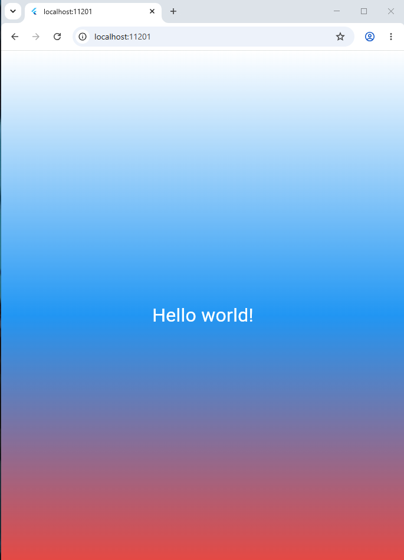

# Проект: First flutter app
Проект создан в рамках лабораторной работы №3. В данном проекте были изучены структура проекта и базовые концепции фреймворка - виджеты и дерево виджетов.
## Автор
**Имя:** Ульяна
**группа:** ИСП-241
## Стек и версии
**Flutter:** 3.47.8
**Dart:** 3.13.7
**Платформа:** Web (Chrome)
**IDE:** VS Code

## Скриншот приложения

## Запуск
1.	Клонировать репозиторий
`git clone url_репозитория`
2.	Перейти в папку проекта
`cd first_fluter_app`
3.	Выполнить
`flutter pub get`
4.	Запустить командой
`flutter run -d chrome`

## Что изучено
- Структура проекта и дерево виджетов.
- Использование базовых виджетов, таких как: `MaterialApp`, `Scaffold`, `Container`, `Center`, `Text`.
- Создание градиентов и стилизация текста.
- Создание своего первого Flutter-проекта.

